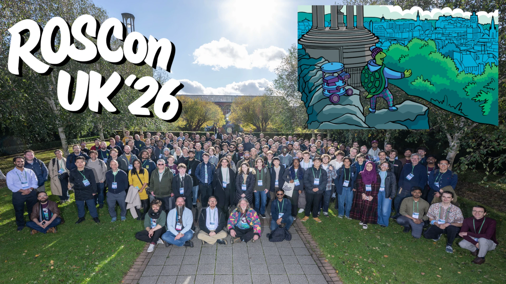
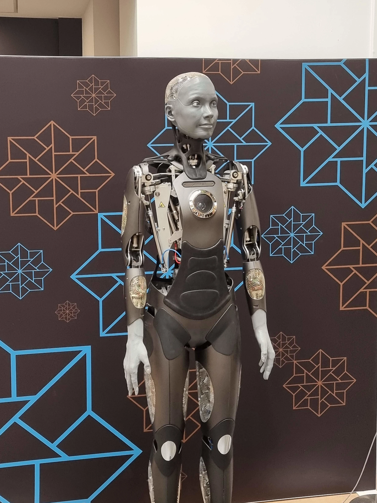
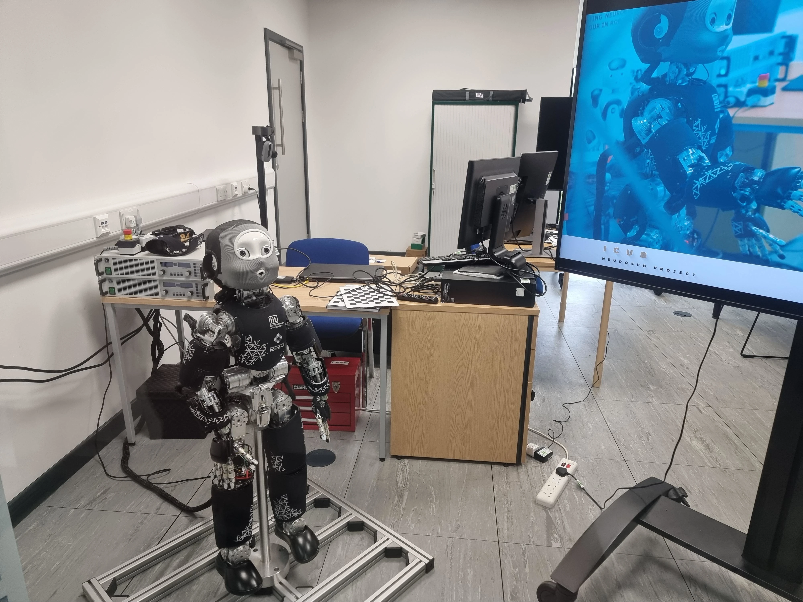
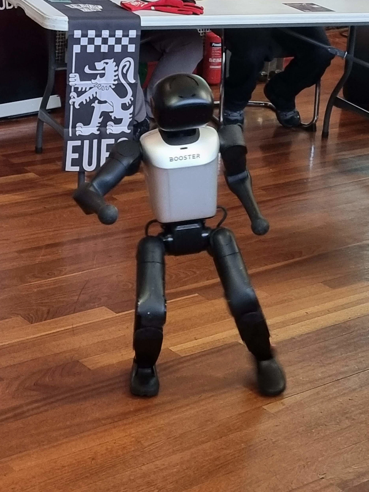

In October, I attended the ROSCon UK 2026 conference in Edinburgh to give a talk about my rover. The talks and workshops were valuable, but the most useful parts were the conversations and community: from the author of the localisation package checking my rover configuration to finding people interested in a Cambridge robotics hackathon.

<!-- truncate -->

<figure class="text--center">

<figcaption>One of the two group photos taken during the event. See if you can spot me holding the Viam Rover!</figcaption>
</figure>

:::note With Thanks

My thanks to [Dr. Bence Magyar](https://www.linkedin.com/in/robotbence/) for inviting me to submit a talk proposal and to the [Tartan Robotics Collective](https://www.tartanrobotics.org/) as a whole for organising the event.

I received free entry to the conference as a media representative, with the understanding that I would write a blog post about my experience.

:::

## Conference Overview

The conference was held from 21-23 October at the [Pollock Estate Complex](https://www.uoecollection.com/conferences-events/venue-hubs/pollock-estate/) in Edinburgh, UK. This put it close (at least, in the same city as) the [National Robotarium](https://thenationalrobotarium.com/), which has some very [interesting robotics](#national-robotarium-tour) going on. Still, I was glad to hear that the next conference is planned to be in Bristol from 5-7 July 2027 -- it's a bit closer to home and at a warmer time of year!

From the [ROSCon UK website](https://roscon.org.uk/2026/), the event "welcomed 240 attendees, representing 42 companies and 21 universities, with a roughly 50/50 split between academia and industry." There are more details on the site about the number of talks, workshops, and other activities. It also has a sign-up form if you want to be notified of updates, including when you can buy tickets for the next conference, if you're interested.

The conference was split across three days:

- Day 1: Tours and birds-of-a-feather sessions
- Day 2: Deep dive talks and workshops
- Day 3: Talks

I'll talk about the major parts of each day as I experienced them over the rest of this post.

## National Robotarium Tour

The first day was primarily tours and birds of a feather sessions. Birds of a feather sessions allow attendees to meet and discuss different subjects, but as the tours were so popular, there weren't too many attendees joining, hence why I'm skipping over these sessions.

In the morning, I went on the tour of the [National Robotarium](https://thenationalrobotarium.com/). This is a centre that was set up four years ago to "test and develop robotic, AI and automated technologies". 

My tour group was led by [Dr Ingo Keller](https://thenationalrobotarium.com/people/senior-management/#ingo), the Head of Robotics at the National Robotarium. We looked at some of the major projects set up by the centre, such as a humanoid powered by AI to talk and answer questions, and a completely functional flat with robotic parts.

<figure class="text--center">

<figcaption>Ameca, the advanced AI-powered humanoid from the National Robotarium.</figcaption>
</figure>

<figure class="text--center">

<figcaption>The Robotarium's [iCub](https://icub.iit.it/), used there for research into Parkinson's disease.</figcaption>
</figure>

Dr Keller insisted on the importance of working directly with companies in the industry, which I strongly agreed with. A common issue in engineering is quietly building a great technical solution that doesn't _quite_ solve the problem it was aimed at. Directly involving the people who would use the robot is really important to build something that is useful and solves real problems.

After being shown around, we had a few presentations by the staff of the Robotarium. We saw flexible robots for sensing cracks in oil pipes, remote monitoring of agriculture, and a repeatable robot arm lab setup with digital twin to allow academics to perform tests in identical environments (among other examples).

I was particularly keen on the Open-RMF demonstration by [Sean Katagiri](https://thenationalrobotarium.com/people/robot-engineers-technicians/#sean). The demonstration showed how a button push could send an autonomous mobile robot (AMR) to collect an object placed on it by a robot arm. Each robot handled only its own behaviour, leaving the overall coordination to Open-RMF and making it easier to add robots or combine them in different ways without changing their individual behaviour. I'd heard of Open-RMF before, but seeing it in action made its value much clearer. Thank you, Sean!

## Deep Dive Talks

The second day had workshops running all day, plus two parallel tracks of deep dive talks. I'm a big fan of hands-on learning, so I'm very happy that so many workshops were available, but the downside was that relatively few people attended the deep dive talks.

I gave one of the deep dive talks, titled 'VSLAM on a Low-Cost Autonomous Rover'. I won't go into details here as it was mostly a summary of my blog posts on the Autonomous Viam Rover (see the [overall post](/blog/autonomous-viam-rover), [`ros2_control` post](/blog/rover-ros2-control), and [calibration post](/blog/viam-rover-calibration)), as well as the lessons learned from building the rover.

I also watched [Gatien Ferret](https://www.linkedin.com/in/gatien-ferret-a851b699/) demonstrate LidarView for visualising lidar data in ROS 2, and [Patrick Robinson](https://www.linkedin.com/in/patrick-robinson-53a2bb153/) discuss debugging and testing the assumptions behind a robot's behaviour.

:::info Share your robotics experience with Patrick

As part of his PhD research, Patrick is looking to interview people working in robotics about the challenges they encounter. If you'd like to share your experience, contact him on [LinkedIn](https://www.linkedin.com/in/patrick-robinson-53a2bb153/) or [by email](mailto:robinsonpaddy4@gmail.com).

:::

[Dr. Aditya Kamath](https://kamathrobotics.com/) presented a practical guide to writing `ros2_control` hardware interfaces for serial bus servos, covering a robot arm and mobile base. This was particularly relevant to a post I’ve been planning, so his work gives me a useful starting point. Take a look at his [blog post on the project](https://kamathrobotics.com/hardware-abstraction-for-sts3215-servos) if you're interested in `ros2_control`, especially when it comes to the [SO-101 robot arm](https://huggingface.co/docs/lerobot/so101) or [LeKiwi mobile robot base](https://www.seeedstudio.com/Lekiwi-Kit-p-6501.html).

## Workshop

I attended the [micro-ROS](https://micro.vulcanexus.org/) workshop 'micro-ROS from Zero: Hands-On with ESP32', which was hosted by [Dr Hsing-Yu Chen](https://thenationalrobotarium.com/people/robot-engineers-technicians/#chen). I was impressed with the workshop because of how well-written the instructions were and because the code is [available open-source](https://github.com/azurechen1203/microros-workshop). I managed to work through the instructions with only a couple of hiccups, and these confused the hosts too!

Having now used micro-ROS, it might have been a good fit for the Radxa X4 on the Autonomous Viam Rover. Currently, the Radxa X4 uses a custom serial protocol to send data back and forth between the Intel N100 and the RP2040, but micro-ROS could simplify communication between the RP2040 and the rest of the ROS 2 system. If I was still working on the project, I'd be tempted to switch it over and see if it simplifies the code.

Take a look at the [source code](https://github.com/azurechen1203/microros-workshop) for the workshop, and if you have or can easily get hold of an [Adafruit QT Py ESP32](https://learn.adafruit.com/adafruit-qt-py-esp32-s2/overview), try it for yourself!

In the future, I'd like to make a video focused on embedded development for robots, which might be focused on [micro-ROS](https://micro.vulcanexus.org/) or something like [iceoryx2](https://iceoryx.io/). I heard about this latter software at FOSDEM 2026 (see my [blog post](/blog/fosdem-robotics-2026)), and it seems to fit in a similar space. If you'd be interested in embedded development for robots, let me know, so I can focus on building this.

## Talks

The third day was lightning talks, full-length talks (15m, as opposed to the 45m for deep dive talks), and keynote talks. As there were quite a few talks, I'll stick to a few of the points I'm taking away!

I didn't know there was an `earth` frame in ROS! The speaker proposed a shared set of map data built for robots. The first step is to make use of the `earth` frame by publishing a transform from `earth` frame to map frame when mapping. With this, you can place the robot on Earth and start to share map data between robots.

I also need to look into nix as a build system. I've used `pixi`, which is excellent software, and nix seems to be along the same lines -- although I've yet to look into both in-depth to check that claim. Either way, as I'm personally not a fan of the huge Docker containers that seem to be the most common method for distributing robot software, either build system would be very welcome.

A talk by [Ava Zahedi](https://www.linkedin.com/in/avazahedi/) from [Locus Robotics](https://locusrobotics.com/) focused on the difficulty of zero-copy IPC, which is a big problem when building robots that pass around a lot of large messages, like camera images or lidar data. I'd be interested to know how her solution compares to other zero-copy solutions, such as [hiroz](https://github.com/ZettaScaleLabs/hiroz) or [iceoryx2](https://iceoryx.io/)!

Thank you to all of the speakers, and my apologies if I didn't mention you here; I didn't want the post to go on for pages and pages. I'll see you next year!

## Community Building

This last section is where I think the highest value of the conference lies: the people building a community together. This was a clear focus of the hosts, who repeatedly spoke about building a community and working together. There were a lot of opportunities for meeting colleagues throughout the conference, from coffee breaks, meals, and after-event drinks to the exhibition hall, where sponsors set up stalls and showed off their robots and technology.

<figure class="text--center">

<figcaption>[Adrian Fowler](https://www.linkedin.com/in/adrian-fowler-186905a/) from [Axis53](https://www.axis53.com/) showing the [Booster K1](https://www.booster.tech/booster-k1/?target=en) humanoid robot! Adrian and I also spoke about recording a video on the K1, so stay tuned.</figcaption>
</figure>

I wanted to include a few people I spoke to, mostly to show the kind of community interactions that are possible at events like these.

[Dexory](https://www.dexory.com/) was one of the gold sponsors of the event, and there were quite a few representatives from the company! [Bob McDonald](https://www.linkedin.com/in/mcdonaldbobby/) and I spoke about the kind of engineers Dexory is looking to recruit, and he confirmed that building a real robot with complex enough software was a great way to catch attention. Finally, [Dr. Marcus Scheunemann](https://www.linkedin.com/in/scheunemann/) described how universities ask him what robotics students should learn, and shared an idea for an event where students tackle real Dexory projects, potentially leading to internships or jobs.

[Locus Robotics](https://locusrobotics.com/), whose colleague Ava Zahedi gave the zero-copy IPC talk [I mentioned earlier](#talks), was another gold sponsor. I also met Tom Moore from Locus, author of the [`robot_localization` package](https://github.com/cra-ros-pkg/robot_localization). Tom saw my talk and checked that I was using EKF correctly in the Autonomous Viam Rover project!

I spoke to [Lucas Colley](https://www.linkedin.com/in/lucascolley0/), maintainer of SciPy and representative from [prefix.dev](https://prefix.dev/), which builds [Pixi](https://pixi.prefix.dev/latest/). Lucas showed me some of the upcoming features from Pixi, including a dashboard that could be used for fleet management. He told me that a great part of attending conferences was getting feedback directly from users, so if you're using Pixi and have something that could be improved, shoot him a message!

I spoke to [Giovanni Funchal](https://www.linkedin.com/in/funchal/), who spoke about the great robotics going on at his new company. He encouraged me to organise a Hackathon in Cambridge and put me in touch with folks from Oxford who had run a similar event. Now I'm in the process of organising such an event. Thanks, Giovanni - maybe I can come and see your robots in action!

[Jim Bruges](https://www.linkedin.com/in/jim-bruges/) from the Arduino stand was also excellent to talk to, because I got to hear about some upcoming releases from Arduino that sound excellent for robotics builders. One of the new boards, the [Arduino Uno Q](https://store.arduino.cc/products/uno-q), seems like a great replacement for the Radxa X4 in my [autonomous rover build](/blog/autonomous-viam-rover), and Arduino is also building a service for designing your own robot! This could be a path to building a new autonomous rover which has all of the parts in stock, although the service has not yet been released.

## Wrap-up

Between the Robotarium tour, the micro-ROS workshop, the talks, and especially the conversations throughout the event, I left with plenty to think about and people I'm glad to have met, not to mention more than a few ideas for future blog posts and videos.

I plan to attend next year as well, especially because it's going to be warmer and closer to home (Bristol, 5-7 July)! Snag a ticket if you can, and let's meet and talk robotics together.
